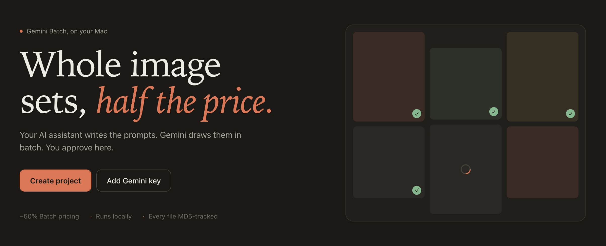

# Gemini Batch Image Generation Kit

Make whole sets of images (stock photos, illustrations, banners) with Google Gemini, at **half the normal
price** through the Gemini **Batch API**. Everything runs on your own computer: a small Python server shows a
dashboard at `http://127.0.0.1:8765`. Nothing is hosted.

This kit is for people who use an **AI assistant** (Claude Code, Codex, Cursor, Gemini CLI...). The assistant
reads [`AGENTS.md`](AGENTS.md) and does the technical work: it writes the prompts, runs the commands and
watches the jobs. You decide what to make and approve the results.



## What you need

- A Mac or Linux computer with Python 3.9 or newer (macOS already has it). Nothing else to install.
- A Gemini API key from [Google AI Studio](https://aistudio.google.com/apikey), with billing turned on.

## Start

```bash
git clone https://github.com/nhanta0408/gemini-batch-image-generation-kit.git
cd gemini-batch-image-generation-kit
```

Then open the dashboard and your AI assistant in this folder:

- **Double-click `Open Dashboard.command`** (macOS), or run `./gbig open`.
- Start your assistant here (for example `claude`) and tell it what you need:
  *"I need 20 photos of a healthy office for our blog, 16:9."*

The dashboard keeps running in the background, even after you close the terminal. Stop it with `./gbig stop`.

## How it works

1. **Create a project** and add your Gemini key (dashboard buttons, or ask the assistant).
2. **Create a batch**: one set of images with a shared topic, look and shape.
3. **Your assistant writes the prompts.** They appear as *Draft prompt*.
4. **Approve** the prompts you want, then press **Generate**. You see the number of images and the cost first.
5. Gemini draws them in batch (usually minutes, at most 24 hours). The dashboard downloads them by itself.
6. **Review**: mark each image *OK*, or *Redo* with a *Quick fix* that tells Gemini what to change.

Read the [quick guide with screenshots](guideline/README.md), or the
[full feature guide](guideline/features.md).

## Where your images go

Your work never mixes with the source code:

- By default everything goes to `output/` in this folder: projects, images, history and logs. `output/` is
  ignored by git, so `git pull` updates the kit without touching your work.
- Or pick any folder when you create a project (for example `~/Pictures`).
- An image that is drawn again is never lost: the earlier version moves to `images/legacy/`.

## Commands

You rarely need these; the dashboard and your assistant cover them.

```bash
./gbig open [project]                        # open the dashboard (starts it if needed)
./gbig stop                                  # stop the dashboard
./gbig key set | check                       # save / test the Gemini API key
./gbig init <name> [--dir <folder>]          # create a project
./gbig use <name> | projects                 # switch / list projects
./gbig new <batch> --topic "..." [--style "..."] [--aspect 16:9]
./gbig import <batch> rows.json [--dry-run]  # add prompts from a file
./gbig gen submit <batch> [--yes]            # without --yes: only shows count and cost
./gbig gen wait [--once] | gen cancel <batch> <job>
./gbig status | audit                        # progress / check every file's MD5
```

## For developers

See [`docs/development.md`](docs/development.md). Run the tests with `python3 -m unittest discover -s tests`
(they use a fake Gemini, so no key and no cost).
