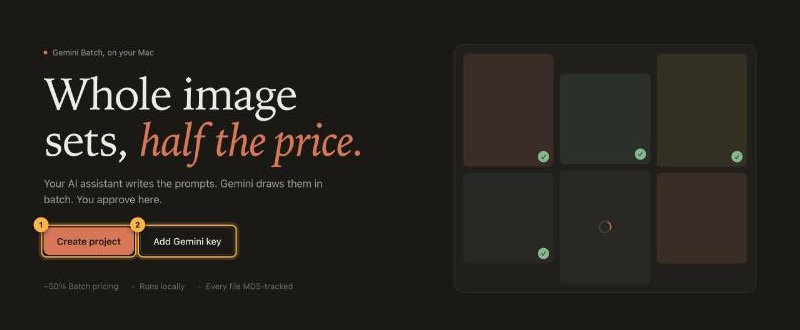
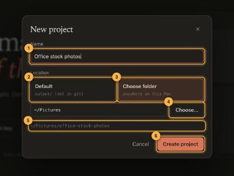
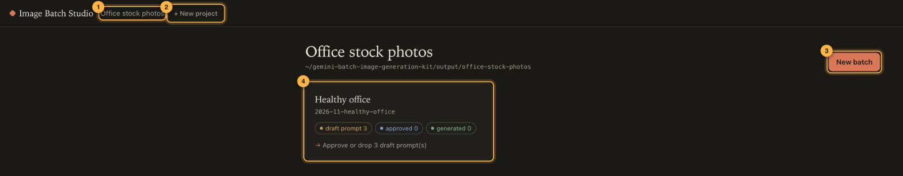
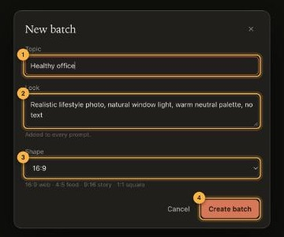
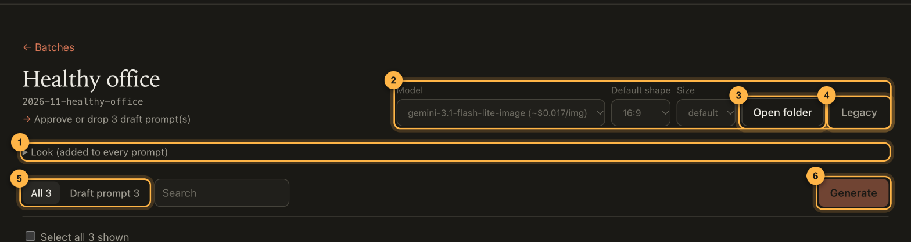
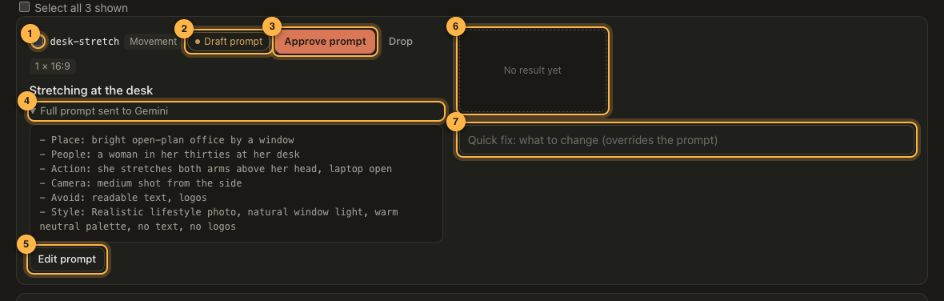
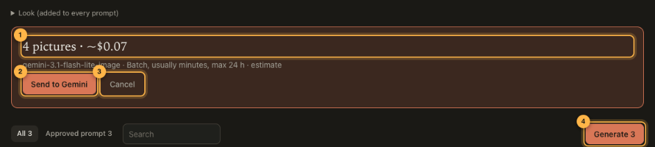
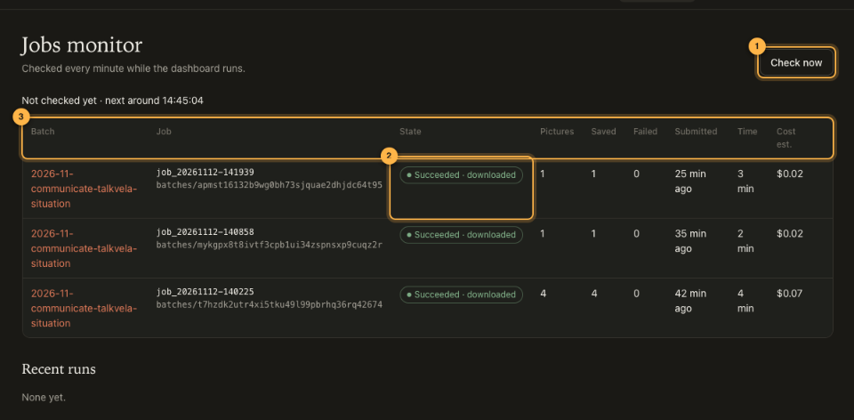
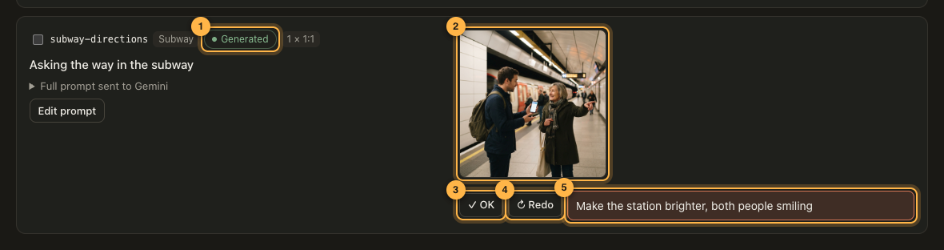
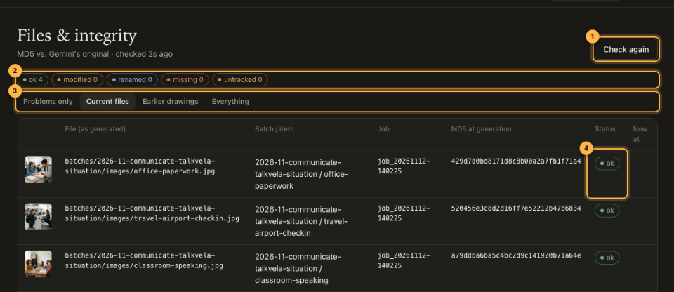

# Quick guide

From an empty folder to finished images in about 10 minutes. The numbers in each screenshot match the list
under it. For every detail, see the [full feature guide](features.md).

## 1. Open the dashboard

Double-click **`Open Dashboard.command`** in the kit folder, or run `./gbig open`. Your browser opens
`http://127.0.0.1:8765`.

1. **Create project**: start here.
2. **Add Gemini key**: paste your key from [Google AI Studio](https://aistudio.google.com/apikey). It is checked
   with Gemini, then saved only on this computer.

The top bar (not shown) has the pages *Batches* (your work), *Jobs monitor* (Gemini progress) and
*Files & integrity* (file checks), plus the key status: click it any time to add or replace the key.

## 2. Create a project

A project keeps one set of images, their prompts and their history together.

1. **Name**: anything you like. The folder name is made from it.
2. **Default**: keep the project in `output/` inside the kit folder (never uploaded to git).
3. **Choose folder**: keep it anywhere else on your computer.
4. **Choose...**: opens the system folder picker.
5. **Preview**: the exact folder that will be created.
6. **Create project**.

## 3. Create a batch

1. **Current project**: when you have several, this becomes a menu to switch.
2. **+ New project**.
3. **New batch**: a batch is one set of images with a shared topic, look and shape.
4. **Batch card**: shows its progress. Click to open it.

1. **Topic**: what the images are about.
2. **Look**: the shared style, added to the end of every prompt (light, colours, photo or illustration...).
3. **Shape**: 16:9 for websites, 4:5 for social feeds, 9:16 for stories, 1:1 square.
4. **Create batch**.

## 4. Get the prompts from your AI assistant

Open your assistant in the kit folder and describe the images: what they are for, how many, and the look.
It writes the prompts and adds them to the batch as **Draft prompt**.

1. **Look**: open to read or change the shared style.
2. **Model, default shape and size** for this batch.
3. **Open folder**: shows the batch's images on your computer.
4. **Legacy**: earlier versions of images that were drawn again.
5. **Filters**: Draft prompt, Approved prompt, Generating, Generated, Redo, Dropped.
6. **Generate**: draws every approved prompt that has no image yet.

## 5. Approve the prompts

1. **Select** several rows to approve, drop or generate them together.
2. **Status**: Draft prompt → Approved prompt → Generating → Generated.
3. **Approve prompt**: only approved prompts are ever sent to Gemini. *Drop* hides a prompt you do not want.
4. **Full prompt sent to Gemini**: exactly what Gemini receives, including the shared look.
5. **Edit prompt**: change the wording, the number of images, or the shape.
6. **Result frame**: empty until the image arrives.
7. **Quick fix**: see step 7.

## 6. Generate

1. **Number of images and estimated cost** (Batch API price, half the normal price).
2. **Send to Gemini**: starts the job. Nothing is paid before you press this.
3. **Cancel**: closes the panel, nothing is sent.
4. **Generate N**: N is the number of approved prompts without an image.

Gemini usually finishes in a few minutes, at most 24 hours. You can close the browser: the dashboard keeps
checking every minute and downloads the images when they are ready.

1. **Check now**: ask Gemini right away instead of waiting for the next check.
2. **State** of each job: Queued, Drawing, Succeeded · downloaded, Failed, Cancelled.
3. Per job: images asked, saved and failed, time taken and estimated cost.

## 7. Review

1. **Generated**: the image is here.
2. **The image**: click to open it full size.
3. **OK**: you are happy with it.
4. **Redo**: draw it again on the next Generate.
5. **Quick fix**: type what to change, then press Redo. It is sent to Gemini *before* the prompt and wins
   over it, so you can fix an image without rewriting the prompt.

The earlier image is kept in `images/legacy/` (the **Legacy** button), never deleted.

## 8. Check your files

1. **Check again**: re-checks every file.
2. **Summary**: `ok` untouched · `modified` edited after generation · `renamed` same image under another
   name (shows where) · `missing` deleted · `untracked` added by hand.
3. **Filters**: problems only, current files, earlier drawings, everything.
4. **Status** of each file, compared with the MD5 recorded when Gemini produced it.

The same summary is written to `memory.md` in the project folder, together with which job made which file.
